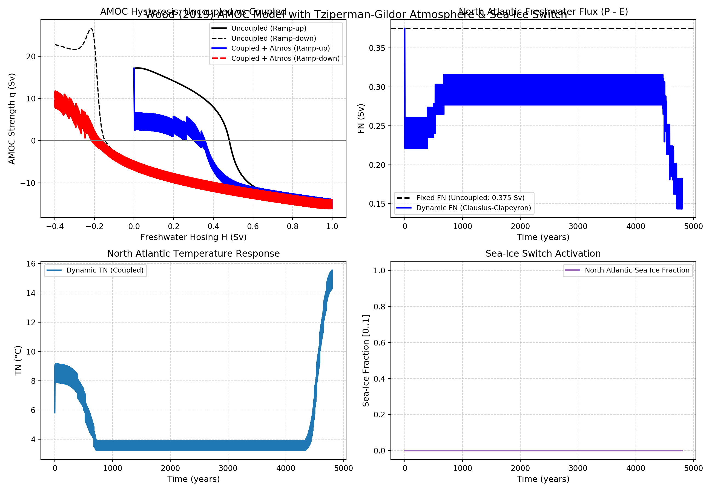

# Wood et al. (2019) AMOC 5-Box Model & Coupled Atmospheric Extensions

A standalone Python implementation of the 5-box dynamical model of the Atlantic Meridional Overturning Circulation (AMOC) described in:

> **Wood, R. A., Rodríguez, J. M., Smith, R. S., Jackson, L. C., & Hawkins, E. (2019).**  
> *Observable, low-order dynamical controls on thresholds of the Atlantic meridional overturning circulation.*  
> **Climate Dynamics**, 53(11), 6815–6834.  
> [DOI: 10.1007/s00382-019-04956-1](https://doi.org/10.1007/s00382-019-04956-1)

This repository includes both the **uncoupled box model** (with all 7 climate model calibrations from Table 1 of the paper) and an **extended coupled version** featuring an active atmospheric energy balance, Clausius-Clapeyron moisture transport, and a polar sea-ice switch adapted from the [Tziperman-Gildor model](https://github.com/gagnagaman/Tziperman_Gildor).

---

## 1. Overview of the 5-Box AMOC Model

The model partitions the global ocean into five contiguous compartments representing dominant large-scale water masses:
- **N (North Atlantic):** Deep water formation region (NADW) and Arctic.
- **T (Atlantic Thermocline):** Subtropical North Atlantic.
- **S (Southern Ocean):** Surface Southern Ocean and Antarctic Intermediate Water (AAIW).
- **IP (Indo-Pacific):** Indo-Pacific thermocline.
- **B (Bottom Water):** Southward-flowing NADW and Circumpolar Deep Water (CDW).

### Flow Formulation ($q$)
AMOC strength $q$ is driven by the North-South density gradient:
$$q = \lambda [\alpha (T_S - T_N) + \beta (S_N - S_S)]$$

Incorporating the linear North Atlantic temperature feedback $T_N = \mu q + T_0$:
$$q = \frac{\lambda}{1 + \lambda \alpha \mu} \left[\alpha(T_S - T_0) + \beta(S_N - S_S)\right]$$

### Salinity Dynamics ($dS_i / dt$)
Salt conservation governs salinity in each box via:
- Overturning advection ($q$)
- Cold Water Path ($\gamma$) vs. Warm Water Path ($1 - \gamma$)
- Subtropical gyre exchange ($K_N, K_S, K_{IP}$)
- Southern Ocean vertical mixing ($\eta$)
- Surface freshwater fluxes ($F_i$) and hosing perturbation ($H \cdot A_i$)

Both forward overturning ($q \ge 0$, Eqs. 2–6) and reversed circulation ($q < 0$, Eqs. 7–11) regimes are implemented.

---

## 2. Model Calibrations (Table 1)

All parameter sets from Table 1 of Wood et al. (2019) are pre-loaded:
1. `FAMOUSA_1xCO2` (Baseline FAMOUS AOGCM pre-industrial run)
2. `FAMOUSB_1xCO2` (Updated FAMOUS pre-industrial run)
3. `FAMOUSB_2xCO2` (FAMOUS at $2\times\text{CO}_2$)
4. `HadGEM2AO_1xCO2` (HadGEM2-AO pre-industrial)
5. `HadGEM2AO_2xCO2` (HadGEM2-AO at $2\times\text{CO}_2$)
6. `HadGEM2AO_4xCO2` (HadGEM2-AO at $4\times\text{CO}_2$)
7. `DePreSys_1999_2008` (Ocean reanalysis state)

---

## 3. Coupled Atmosphere & Sea-Ice Extension

In Section 5.1 of Wood et al. (2019), the authors noted that omitting interactive atmospheric freshwater feedbacks causes box models to underestimate the AMOC sensitivity to freshwater forcing.

In `coupled_wood_tziperman.py`, the 5-box ocean is coupled to the atmospheric moisture transport and sea-ice switch from [Gildor & Tziperman (2001)](https://github.com/gagnagaman/Tziperman_Gildor):
1. **Dynamic Moisture Transport ($F_N$ & $F_T$):** Atmospheric water vapor capacity follows the **Clausius-Clapeyron** relation ($q_{\text{spec}} \propto \exp(-B/\theta)$). Poleward vapor transport from the subtropics dynamically sets the North Atlantic freshwater input:
   $$F_N(t) = K_{Wa} \frac{\theta_T - \theta_N}{L} q_{\text{spec}}$$
2. **Polar Sea-Ice Switch:** When the AMOC collapses and $T_N \le 1^\circ\text{C}$, sea ice forms. This triggers:
   - **Albedo feedback:** surface albedo jumps from $\alpha_S = 0.07$ to $\alpha_{SI} = 0.65$.
   - **Insulation & Hydrological shutoff:** ocean heat loss and local evaporation are suppressed.

### Comparison Results:
| Model Configuration | Collapse Threshold $H_{\text{crit}}$ | Recovery Threshold $H_{\text{crit}}$ |
|---|---|---|
| **Uncoupled Wood (2019)** | **0.481 Sv** | **-0.147 Sv** |
| **Coupled Wood + Atmosphere & Sea Ice** | **0.305 Sv** | **-0.164 Sv** |



---

## 4. Repository Structure

```
WoodAMOC/
├── wood_box_model.py          # Core Wood et al. (2019) model classes and equations
├── simulate.py                # CLI script to run uncoupled hysteresis experiments
├── plot_comparison.py         # Multi-model comparison across CO2 scenarios (Fig. 5)
├── coupled_wood_tziperman.py  # Coupled Wood AMOC + Tziperman Atmosphere & Sea-Ice
├── unesco.py                  # UNESCO (1981) seawater equation of state
├── figures/                   # Diagnostic PNG figures
│   ├── amoc_hysteresis_FAMOUSA_1xCO2.png
│   ├── salinity_evolution_FAMOUSA_1xCO2.png
│   ├── figure5_comparison.png
│   └── wood_tziperman_comparison.png
└── README.md                  # Documentation
```

---

## 5. Usage

### Run Baseline Uncoupled Simulation (FAMOUSA):
```bash
python3 simulate.py --model FAMOUSA_1xCO2
```
Outputs $H_{\text{crit}}$ collapse and recovery values, and saves:
- `figures/amoc_hysteresis_FAMOUSA_1xCO2.png`
- `figures/salinity_evolution_FAMOUSA_1xCO2.png`

### Run All 7 Calibrations:
```bash
python3 simulate.py --model all
```

### Reproduce Multi-Model Comparison (Figure 5 in Paper):
```bash
python3 plot_comparison.py
```
Outputs `figures/figure5_comparison.png`.

### Run Coupled Wood + Tziperman-Gildor Atmosphere Model:
```bash
python3 coupled_wood_tziperman.py
```
Outputs `figures/wood_tziperman_comparison.png`.

---

## Companion Repository
- **[Tziperman_Gildor](https://github.com/gagnagaman/Tziperman_Gildor)**: Standalone 8-box coupled ocean-atmosphere-sea ice model based on Gildor & Tziperman (2001).
